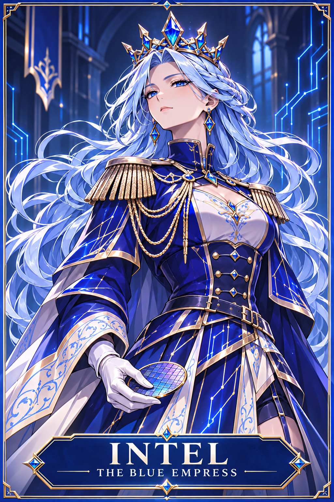
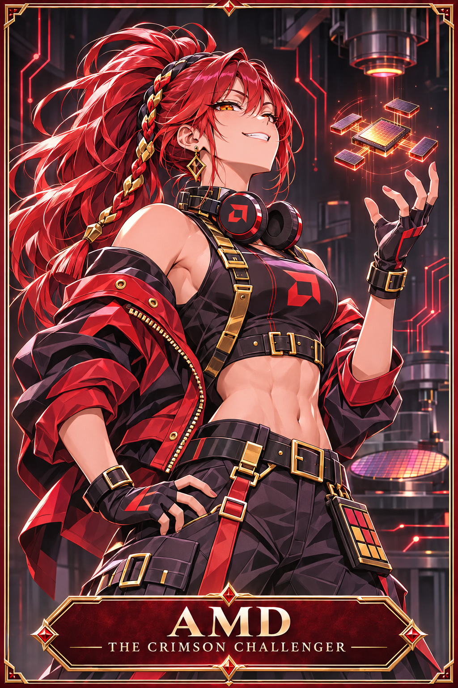
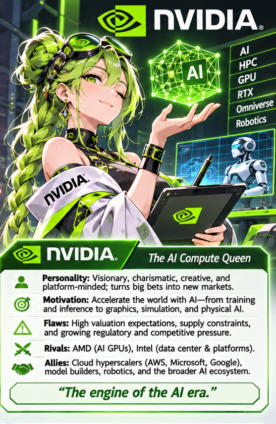

# Silicon Wars

<table>
  <tr>
    <td align="center"> <strong>Intel</strong></td>
    <td align="center"> <strong>AMD</strong></td>
    <td align="center"> <strong>Nvidia</strong></td>
  </tr>
</table>

A manga universe personifying technology, AI, and semiconductor companies. Fictional fan art unaffiliated with the companies.

| Folder | What lives there |
| --- | --- |
| [bible/](bible/README.md) | Series canon, story arcs, and visual continuity |
| [characters/](characters/INDEX.md) | 32 Season 1 profiles with art prompts and available illustrated references |
| [chapters/](chapters/README.md) | Scripts, storyboards, panel source, and lettering |
| [layouts/](layouts/README.md) | Reusable page geometry and reading order |
| [workflows/](workflows/README.md) | Generation and review conventions |
| [index.html](index.html) | Character reference-card gallery |
| [tools/](tools/README.md) | Local gallery preview builder |
| [tutorial/](tutorial/README.md) | Illustrated AI manga production and GitHub guide |
| [external/](external/README.md) | Four pinned upstream tools |
| [scratchpad/](scratchpad/README.md) | Original group artwork and legacy templates |

Start with the [character gallery](index.html) or the [six-panel production pilot](chapters/pilot-001/README.md). A regular clone contains all series artwork and tutorial images. Initialize a submodule when you need its upstream tooling.
