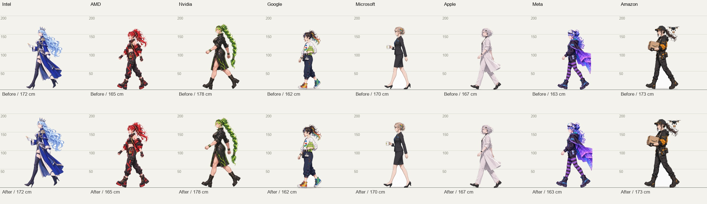
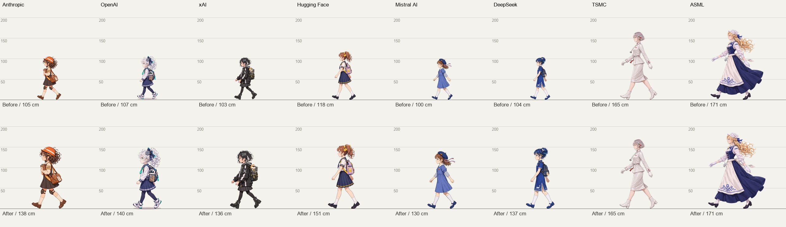
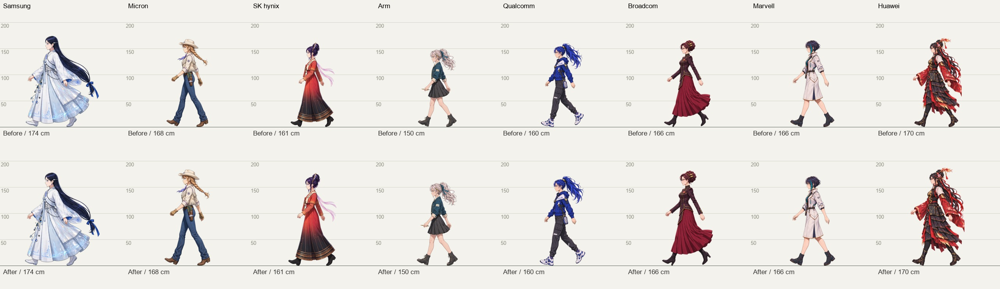
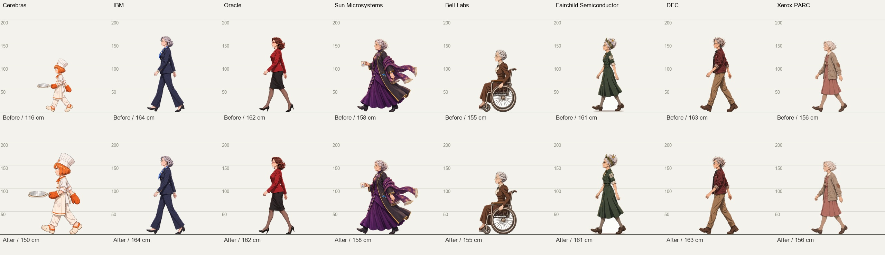

# ED Walk height-correction review — 2026-11-14

User request: inspect the cast, correct canonical heights where characters look out of scale, and rebuild the ED Walk.

## Result

Reviewed all 32 original cutouts and the six rebuilt slices. The five elementary-school girls were previously scaled to 100–107 cm; Hugging Face and Cerebras, whose profiles describe them as 12–13, were 118 and 116 cm. These values made the younger cast read much too small beside the adults. The revised heights retain their relative ordering while separating elementary, middle-school, and adult portrayals. No adult height changes were needed.

| Character | Before | Revised | Reason |
| --- | ---: | ---: | --- |
| Anthropic | 105 cm | 138 cm | Elementary-school portrayal |
| OpenAI | 107 cm | 140 cm | Elementary-school portrayal |
| xAI | 103 cm | 136 cm | Elementary-school portrayal |
| Hugging Face | 118 cm | 151 cm | Middle-school portrayal, about 12–13 |
| Mistral AI | 100 cm | 130 cm | Elementary-school portrayal; Mistral remains the shortest |
| DeepSeek | 104 cm | 137 cm | Elementary-school portrayal |
| Cerebras | 116 cm | 150 cm | Middle-school portrayal, about 12–13 |

The remaining 25 canonical heights are unchanged. [All 32 current heights](../../../../characters/HEIGHTS.md). These values, hidden skull positions and footwear lifts are explicit art-direction estimates. A stylized image alone cannot establish an absolute centimeter height. No claim of clinical or sub-centimeter anatomical precision is made.

## Scaling correction

The old compositor set the entire cutout box to the canonical height, including crowns, hats and shadows. The new compositor scales from the estimated anatomical crown to the supporting shoe sole at 1500/168 pixels per centimeter, adding a separate footwear allowance to barefoot stature. Headwear, ponytails and props no longer consume body height. Supporting soles (or wheelchair wheels) share a baseline, with background shadow allowed below it. Bell Labs retains the earlier art-directed 134.85 cm seated crown-to-floor span, now explicit rather than an implicit 0.87 multiplier. Her standing height remains 155 cm.

The 32 inspected source-pixel landmark pairs, footwear allowances and source hashes are in [height-calibration.json](../../height-calibration.json). The compositor refuses stale source hashes. Uniform resizing preserves the original anatomy, poses, costume details, faces, logos and lettering; no generation, mirroring or body warping was used. Walkers and transparent cutouts are unchanged.

## Before / after

Each comparison uses the same pixels-per-centimeter scale, with the old placement above and revised placement below. Grid values are centimeters above each baseline, not labels identifying the top of headwear. Bell Labs is labeled by standing stature in both rows while her artwork remains seated.

### Compute triad and platforms

### AI Academy, TSMC and ASML

### Foundry, memory and chip companies

### Cerebras and the elder generation

[Previous panorama, reduced web copy](before.webp) · [Corrected full-resolution panorama](../../ed-walk-full.png)

`before.json` records every old canonical height and the original full-resolution PNG hash (the source PNG remains recoverable from Git). [ed-walk.render.json](../../ed-walk.render.json) records current input hashes, placements and slice bounds. No files under `scratchpad/originals/` were touched.

## Verification

- All 32 calibration records match their source cutout hashes and dimensions.
- Rendered crown-to-ground spans agree with targets within one output pixel (about 0.112 cm of numerical rounding, separate from landmark estimation uncertainty).
- All supporting-ground landmarks land on the same baseline, every full cutout fits inside the canvas, and all figures retain uniform aspect ratio within pixel rounding.
- Six posting slices cover the panorama contiguously and match their full-image crops pixel for pixel.
- Reviewed all four comparisons and all six panorama slices at readable size: roster order and left-facing direction preserved, no new face or lettering changes, no top/bottom clipping.
- Website derivative regenerated to 10,000 × 935; the artwork index and detail page use its updated dimensions.

Rebuild: `py -3 tools/build_ed_walk.py --composite-only`. Tests: `py -3 -m unittest discover -s tools/tests -p test_ed_walk.py`.

Status: implemented for user review. The source-dependent anatomical landmarks remain estimates, especially under headwear and in walking poses.
