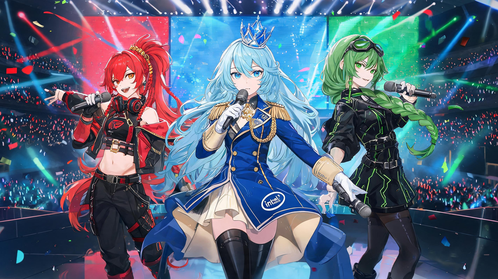
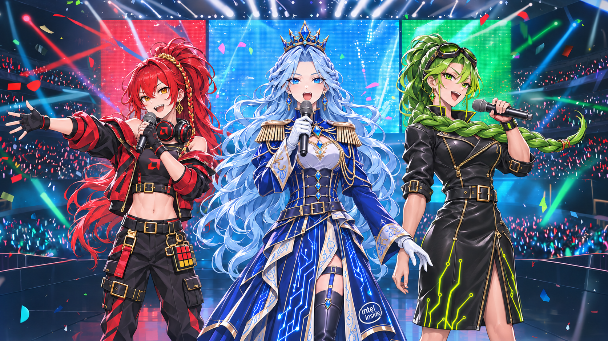

# Concert key art regeneration — 2026-11-14

Replaced the concert illustration at the user's request: AMD had an extra hand and the trio's designs drifted from their model sheets. The current revision adds clearly open singing mouths for Intel and Nvidia, removes Intel's lowered spare microphone, and brings Nvidia's braid across her chest in the original image's sideways sweep. It retains the head-level camera, straight-facing Intel, and AMD's two-arm pose.

## Before and after

Before:

After:

## Inputs and output

- Identity: canonical character sheets for [AMD](../../../characters/amd/character_sheet.png), [Intel](../../../characters/intel/character_sheet.png), and [Nvidia](../../../characters/nvidia/character_sheet.png), checked against profiles and continuity records.
- Current edit target: [eye-level version](eye-level-v4.png). The [original concert illustration](before.jpg) supplies only Nvidia's forward-swept braid pose for this local correction. The [full-body attempt](full-body-v2.png) and [rejected upward-camera attempt](rejected-camera-v3.png) remain preserved for comparison and are not inputs to the current generation.
- Lettering: no title or dialogue baked into the image; costume emblems retained. The page title remains HTML.
- [Current singing and braid-correction prompt](../key-art-singing.prompt.txt), using the built-in `image_gen` tool with the eye-level version and original braid reference. The [eye-level prompt](../key-art-eye-level.prompt.txt) and earlier prompts remain preserved with their render records.
- [Render provenance and hashes](../key-art.render.json).
- Source: [lossless PNG](../key-art.png). Website derivative: JPEG quality 95, no chroma subsampling.

## Visual review

Inspected enlarged crops of AMD's shoulders, elbows, wrists and hands. Her outer arm extends left to an open hand; her inner arm crosses her chest to a single microphone-gripping hand. Both wear black fingerless gloves. There is no third arm or hand at her waist or microphone.

Intel faces straight toward the viewer with level eyes and square shoulders, now with a clearly open singing mouth. One white-gloved hand holds her microphone below her mouth; her other arm extends diagonally downward to a relaxed empty hand. Nvidia also has a clearly open singing mouth, holds her microphone up and lets her other arm hang down. There are three microphones total, one per character, with two arms and two hands per character.

AMD retains her fiery ponytail, threaded braid, headphones, harness, cropped jacket, cargo trousers and hip chiplets. Intel wears the sapphire crown, circuit-patterned imperial coat, cream panels, gold epaulettes and white gloves, with her skirt emblem visible at the lower edge. Nvidia has goggles, broader shoulders and strong forearms, asymmetric leather dress, green circuit seams and bare legs. Her single thick braid now passes over her shoulder across the front of her upper chest and sweeps sideways to image-right with an upturned tail, rather than hanging behind her hip. Boots remain outside the crop.

Checked the full composition, enlarged mouth/hand/braid crops, and a 768-pixel-wide preview matching the maximum index card width. All three singing mouths are visible, Intel's lowered hand is empty, and only three microphones remain. The camera is level with their heads, Intel's head and body face forward, and her lowered hand stays at its natural scale rather than reaching toward the lens. Left-to-right order remains AMD, Intel, Nvidia. AMD's microphone arm crosses her chest to allow the microphone/outstretched-hand gesture with only two arms. Emblems are generated illustrations rather than exact vector reproductions.

The index and detail page both use the replacement JPEG, updated intrinsic dimensions and a cache version. The original export in `导出/key-art.jpg` is unchanged.
