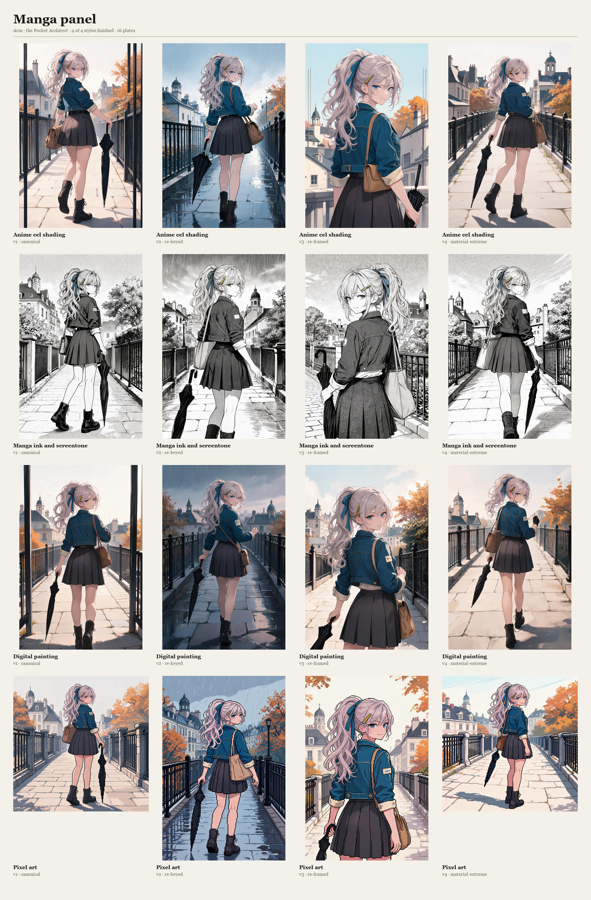

# Arm · cross-era art-style study

One character, one pose, 105 styles. The point is to see how much of a girl survives a
change of medium, and how much the medium rewrites her.

Arm — the Pocket Architect — is drawn in the pose of the supplied reference
(`scratchpad/originals/pose-reference.png`): walking away down a pale stone footpath
between iron railings, head turned back over her right shoulder, folded umbrella in her
right hand, shoulder bag on her left. Only the rendering changes.



## What is here

- `index.html` — the whole atlas. Finished plates appear as images, unfinished ones as
  slots that name the variant they are waiting for.
- `sheets/<family>.png` — contact sheets for each family once every style in it is
  finished: four variants per style, one style per row.
- `renders/<plate-id>.png` — one plate per file, ~1664×2496, RGB PNG.
- `renders/<plate-id>.json` — the accepted generation record for that plate: the verbatim
  prompt, its SHA-256, the reference sheet and its SHA-256, the model, UTC timestamp and
  the image hash. The record sits beside the render, not in a separate log.
- `plates.json` — the manifest: every plate's id, family, style, variant axis, medium
  definition and prompt.
- `PLATES.md` — a tick-list of all 219 plates.

## The 105 styles

Counted the way the brief listed them:

| Group | Styles | Plates |
|---|---|---|
| Four variants each | 38 | 152 |
| One study image | 60 | 60 |
| Video-game eras (added) | 7 | 7 |
| **Total** | **105** | **219** |

## The four variants

Every four-variant style gets the same four moves, so the four plates read as one study
rather than four unrelated pictures:

1. **canonical** — the textbook application of the medium, clear daylight, full figure,
   the reference staging intact.
2. **re-keyed** — same staging and medium, re-keyed to late-afternoon rain.
3. **re-framed** — waist-up three-quarter view, so the surface handling can be read.
4. **material-extreme** — the medium's signature artifacts pushed to the front.

## Pose or inspiration

The brief splits two ways and the library encodes it:

- `mode: pose` — styles whose subject is a **medium** (watercolour, oil, screentone,
  pixel art, mosaic, batik…) hold the reference pose exactly. The variable is the
  material.
- `mode: language` — styles whose subject is a **visual language** (Cubism, Surrealism,
  Op Art, Constructivism, De Stijl, Land Art…) keep the girl, the umbrella, the street
  and the autumn, but are allowed to rebuild the picture space, viewpoint and scale as
  that language demands.

## Identity rules

The character block is copied from `characters/arm/continuity.yaml` and
`characters/arm/art_prompt.md`, and is identical in all 219 prompts: silver ash-blonde
side ponytail with the blue-teal ribbon, cool blue eyes, brass pencil behind the right
ear, cropped blue-teal jacket with the cream chest patch and rolled cream cuffs, cream
shirt, charcoal pleated skirt, dark lace-up boots. No plate may add characters,
lettering, signatures or a gallery frame — a style study is not a story panel, and
`bible/art_style.yaml` governs canon separately.

A "medium fidelity" line is appended to every prompt except the three that are already
supposed to look like anime or pixels, because the renderer pulls everything back toward
glossy anime cel shading otherwise.

## Rebuilding

```
python tools/style_study/build_study.py     # regenerate plates.json + PLATES.md
python tools/style_study/save_plate.py <plate-id> "<imageUrl>"   # add one render
python tools/style_study/build_atlas.py     # regenerate index.html + sheets/
```

`build_study.py` preserves the recorded prompt of any plate already rendered, so
editing the template never rewrites the history of a finished plate.

## Status

65 of 219 plates are rendered (29.7%): the whole `Manga panel` family, six of the seven
four-variant media in `Drawing, paint, and paper`, and six of the seven video-game eras.

Two shortfalls to record honestly:

- The NES plate's first take read as modern pixel art rather than 8-bit, and the
  tightened replacement could not be generated, so `Video game eras` is 6/7.
- **The image account reached its generation limit part-way through the build**
  (`managed_model_points_insufficient`), so the remaining 154 plates are specced,
  prompted and queued in `plates.json` but not yet drawn. Re-running `save_plate.py`
  per id against a refreshed account fills the atlas and the website with no other
  changes.

## Teaching page

`website/artwork/` is a 17-lesson course built from these plates: one lesson per view,
105 styles grouped into a teaching sequence, every style linking out to Wikipedia and
Smarthistory. Lesson 00 explains the method and the four variant axes; the rest walk
through media, print, camera, narrative, craft, staging, public life, landscape,
emotion, abstraction, design, architecture, performance and game hardware. The header
and colophon state that every image was generated with Seedream.

## Rebuilding

```
python tools/style_study/build_study.py     # regenerate plates.json + PLATES.md
python tools/style_study/save_plate.py <plate-id> "<imageUrl>"   # add one render
python tools/style_study/build_atlas.py     # regenerate index.html + sheets/
python tools/style_study/build_web.py       # regenerate the website course data
```

`build_study.py` preserves the recorded prompt of any plate already rendered, so
editing the template never rewrites the history of a finished plate.

`PLATES.md` holds the live tick-list and `index.html` the rendered count.
