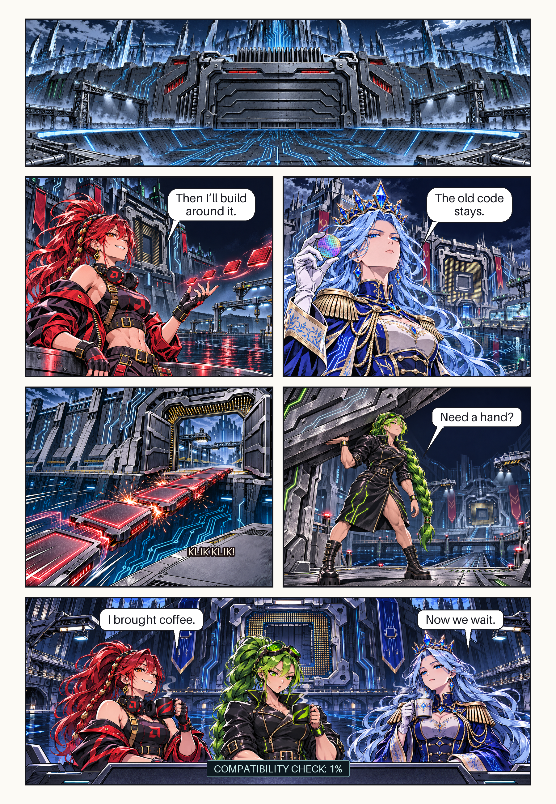

# Pilot 001 · The Compatibility Test

A one-page production test for Intel, AMD, and Nvidia. Read the paired rows from right to left.



- [Script](script.md), [rough storyboard](storyboard.svg), and [panel order](pages/page-001/storyboard.yaml)
- [Panel briefs](pages/page-001/panels/) and [editable lettering](pages/page-001/lettering.yaml)
- [Render plan](render.yaml), [generation manifest](pages/page-001/manifest.yaml), and [review checklist](qa.yaml)

The ZIP contributed the compatibility-test premise, per-panel briefs, shared prompt, separate lettering, generation manifest, and review gate. This adaptation uses the current character PNGs and color so the cast’s designs are easy to compare. The page is a review draft.

Run from the repository root to assemble the page again or change a line of dialogue.

```sh
python -m pip install "Pillow>=10.1" PyYAML
python tools/render_pilot.py --check
python tools/render_pilot.py
```

To regenerate one panel, print its prompt with `python tools/render_pilot.py --prompt panel-03`. Attach the PNG references listed in its brief in order. Replace that panel’s art after review, update its manifest entry, and reassemble. The renderer assembles existing art and lettering locally.
