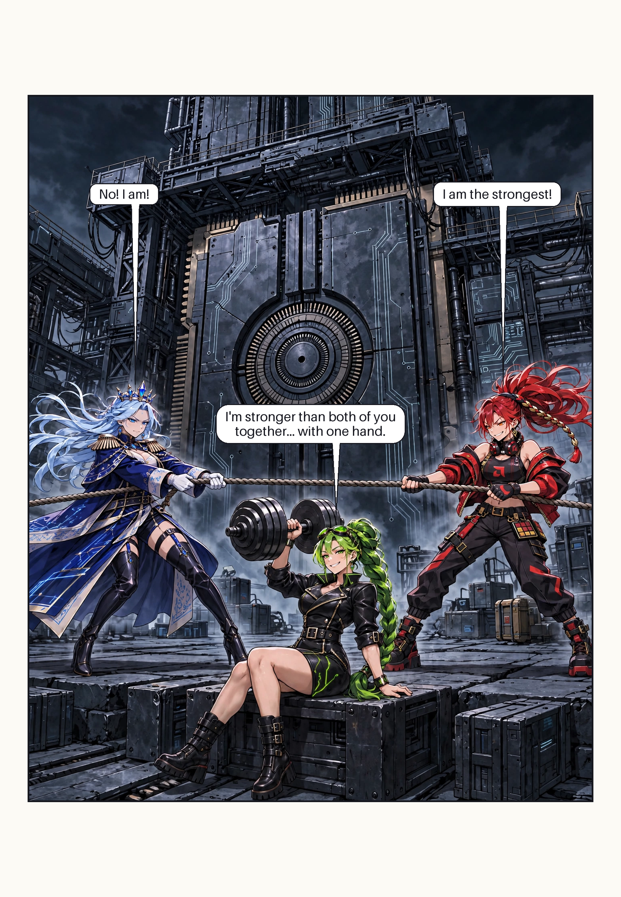
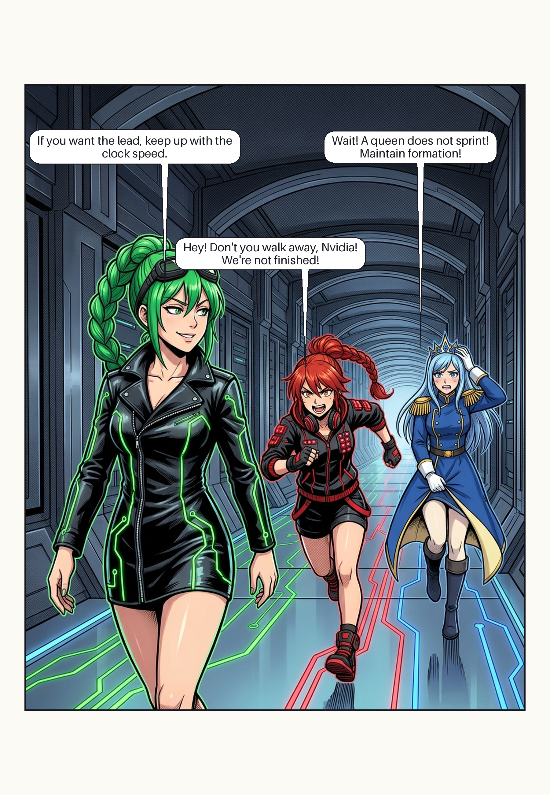

# Pilot 001 · The Compatibility Test

A production test for Intel, AMD, and Nvidia. Page 001 is six panels — read the paired rows from right to left. Page 002 and Page 003 are single splash panels.


- [Script](script.md), [rough storyboard](storyboard.svg), and [panel order](pages/page-001/storyboard.yaml)
- [Panel briefs](pages/page-001/panels/) and [editable lettering](pages/page-001/lettering.yaml)
- [Render plan](render.yaml), [generation manifest](pages/page-001/manifest.yaml), and [review checklist](qa.yaml)

## Page 002 · The Tug of War



Intel and AMD are deadlocked in a tug of war; Nvidia, seated in the foreground, presses a massive dumbbell with one hand and settles the argument.

- [Panel brief](pages/page-002/panels/panel-01.yaml) and [editable lettering](pages/page-002/lettering.yaml)
- [Panel order](pages/page-002/storyboard.yaml) on the reusable [single-panel layout](../../layouts/single-panel.yaml), [render plan](render-page-002.yaml), and [generation manifest](pages/page-002/manifest.yaml)

Assemble it the same way, with its own render plan:

```sh
python tools/render_pilot.py --plan chapters/pilot-001/render-page-002.yaml --check
python tools/render_pilot.py --plan chapters/pilot-001/render-page-002.yaml
```

## Page 003 · The Line Walk



The trio walks in a line down the x86 Citadel corridor: Nvidia strides ahead calmly in the lead, AMD sprints dynamically to chase her down, and Intel hurries behind trying to maintain her imperial decorum.

- [Panel brief](pages/page-003/panels/panel-01.yaml) and [editable lettering](pages/page-003/lettering.yaml)
- [Panel order](pages/page-003/storyboard.yaml) on the reusable [single-panel layout](../../layouts/single-panel.yaml), [render plan](render-page-003.yaml), and [generation manifest](pages/page-003/manifest.yaml)

Assemble it with its render plan:

```sh
python tools/render_pilot.py --plan chapters/pilot-001/render-page-003.yaml --check
python tools/render_pilot.py --plan chapters/pilot-001/render-page-003.yaml
```

---

The ZIP contributed the compatibility-test premise, per-panel briefs, shared prompt, separate lettering, generation manifest, and review gate. This adaptation uses the current character PNGs and color so the cast’s designs are easy to compare. The page is a review draft.

Run from the repository root to assemble the page again or change a line of dialogue.

```sh
python -m pip install "Pillow>=10.1" PyYAML
python tools/render_pilot.py --check
python tools/render_pilot.py
```

To regenerate one panel, print its prompt with `python tools/render_pilot.py --prompt panel-03`. Attach the PNG references listed in its brief in order. Replace that panel’s art after review, update its manifest entry, and reassemble. The renderer assembles existing art and lettering locally.

## Page 002 · Courtyard chibi alternate

In this 4:3 review panel, Intel and AMD are on one team. Nvidia pulls them with one hand and curls a dumbbell with the other. The speech balloon is part of the rendered image.

[View the courtyard panel](pages/page-002-chibi/alternates/courtyard-4x3/panel-01.png) · [Generation notes](pages/page-002-chibi/alternates/courtyard-4x3/panel-01.prompt.md)
