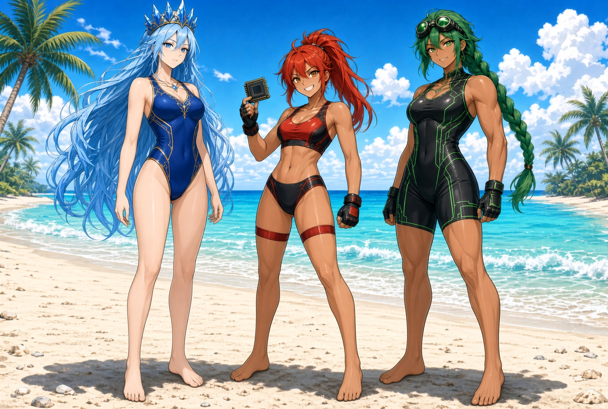
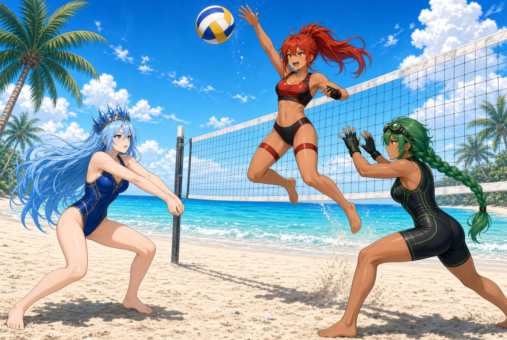

# Pilot 003 · Beach Day

Casual beach sequence featuring the Compute Triad (Intel, AMD, Nvidia) in swimsuit variants based on character bible continuity.

## Pages

### Page 001 — Standing on the Beach
Barefoot, full-body group shot in color-themed swimsuits.

### Page 002 — Beach Volleyball
Action scene with volleyball net, barefoot, dynamic poses.

## Continuity notes
- Intel: long light-blue hair, sapphire crown, blue swimsuit with gold accents, composed.
- AMD: fire-red high ponytail, amber eyes, red/black athletic swimsuit, energetic.
- Nvidia: emerald-green braid, goggles, strong build, black swimsuit with green circuit accents, confident.

Generated via iterative AI image editing from character profiles. Not canonical production art; exploratory swimsuit/beach concept.
