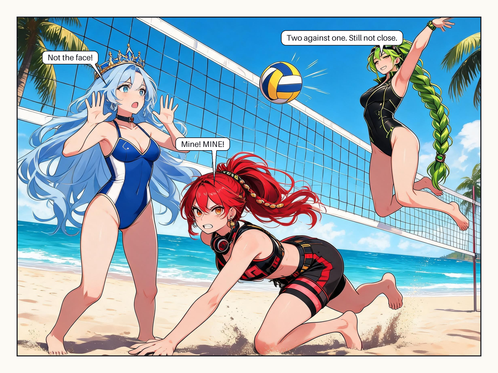

# Pilot 005 · Beach Volleyball

A single 4:3 comedy panel. Intel, AMD and Nvidia play beach volleyball; two of them go for the same ball and neither reaches it.



- [Script](script.md) and [chapter record](chapter.yaml)
- [Panel brief](pages/page-001/panels/panel-01.yaml), [storyboard](pages/page-001/storyboard.yaml), and [editable lettering](pages/page-001/lettering.yaml)
- [Render plan](render-page-001.yaml), [generation manifest](pages/page-001/manifest.yaml), and [review checklist](qa.yaml)

The art is generated text-free on the [4:3 single-panel layout](../../layouts/single-panel-4x3.yaml); the balloons are composited from `lettering.yaml` at assembly time. The reference passed to the generator is a [cast sheet](pages/page-001/refs/cast-reference.jpg) built from the three character sheets and their expression sheets, so faces, hair, accessories and palettes come from the approved design art rather than from a text description alone. The swimsuits carry over from the [pilot-003 beach concept](../pilot-003/README.md).

## Reassemble

```sh
python tools/render_pilot.py --plan chapters/pilot-005/render-page-001.yaml --check
python tools/render_pilot.py --plan chapters/pilot-005/render-page-001.yaml
```

Print the exact art prompt with `python tools/render_pilot.py --plan chapters/pilot-005/render-page-001.yaml --prompt panel-01`. To change a line, edit `pages/page-001/lettering.yaml` and reassemble; the panel art is untouched.
