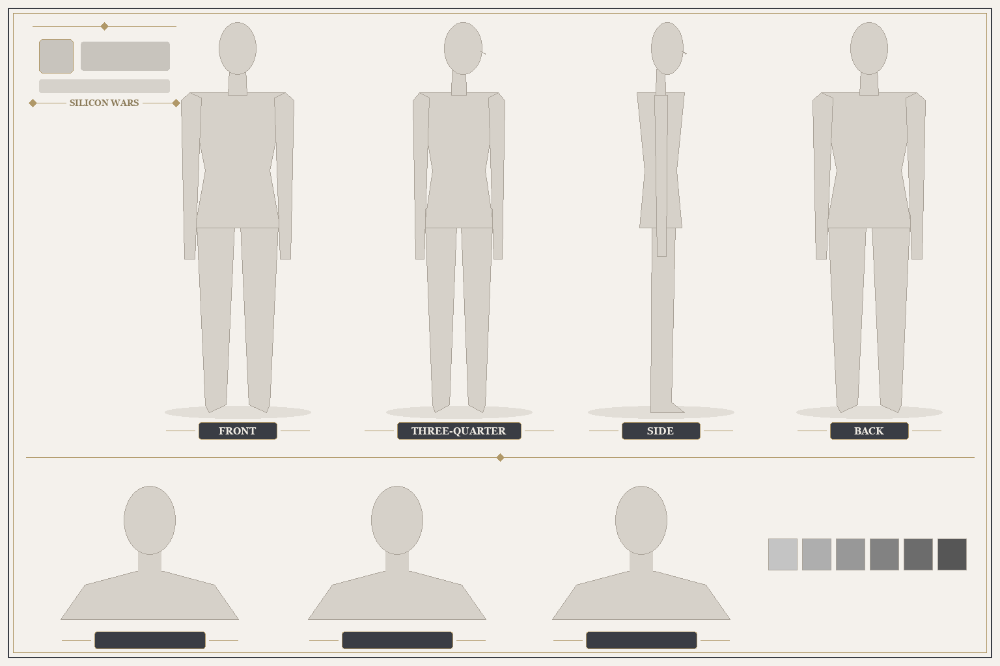
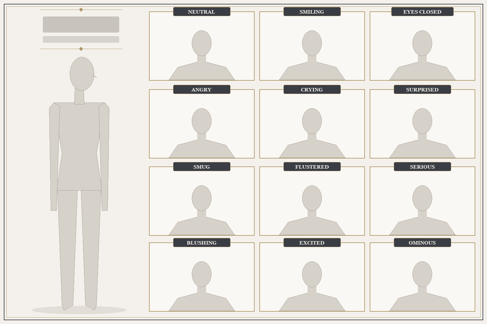
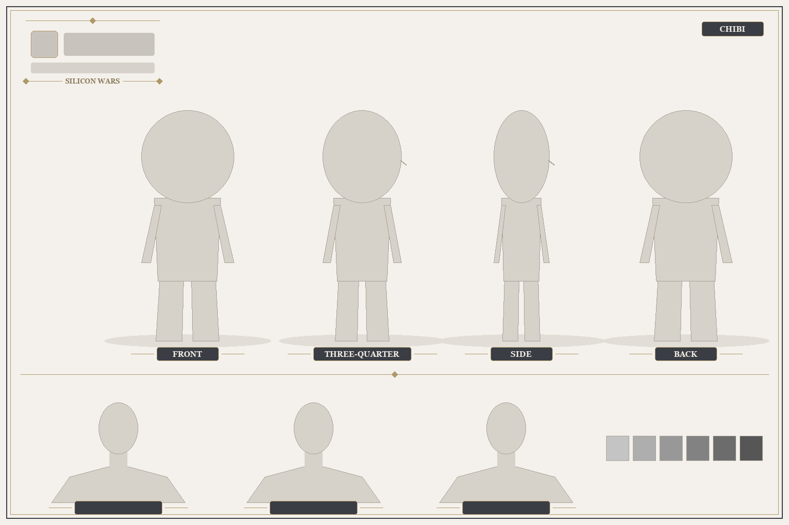
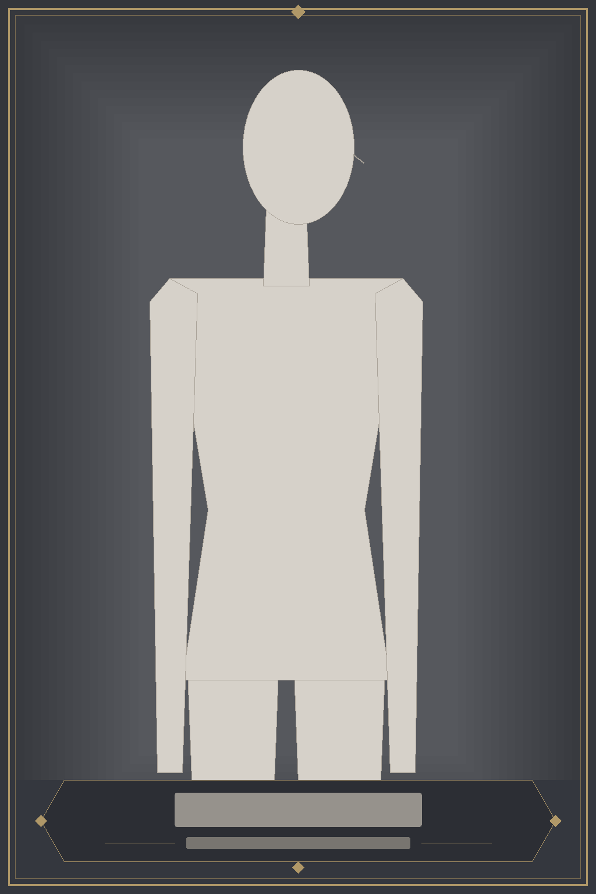

# Character template

Templates for a character's written profile and for the three design assets each main character gets: a **model sheet**, a **reference card**, and an **expression sheet**. They are built from how [Intel](../intel/character_sheet.prompt.md), [AMD](../amd/character_sheet.prompt.md), and [Nvidia](../nvidia/character_sheet.prompt.md) were generated, with fixes learned from [Microsoft](../microsoft/character_sheet.prompt.md). This folder is not a character, and it is not listed in the roster.

## Contents

| File | Use |
|---|---|
| [profile.md](profile.md) | Character profile (README): short roster fields plus character depth |
| [prompts/model_sheet.prompt.md](prompts/model_sheet.prompt.md) | Four-view turnaround, three close-ups, palette |
| [prompts/reference_card.prompt.md](prompts/reference_card.prompt.md) | 2:3 painted portrait with a two-line nameplate |
| [prompts/expressions.prompt.md](prompts/expressions.prompt.md) | One full body plus 12 labeled faces |
| [prompts/chibi_sheet.prompt.md](prompts/chibi_sheet.prompt.md) | Chibi turnarounds, close-ups, palette, with the locked CHIBI tag |
| [prompts/edit_pass.prompt.md](prompts/edit_pass.prompt.md) | Targeted correction of an accepted image |
| [layout/](layout/) | Blank layout guides to pass as Image 2 (see below) |
| [character_sheet.prompt.md](character_sheet.prompt.md) | Skeleton of the generation record |
| [continuity.yaml](continuity.yaml) | Skeleton of the continuity lock |

### Layout guides

| Guide | Size | Matches |
|---|---|---|
|  [model_sheet_layout.png](layout/model_sheet_layout.png) | 1536 x 1024 | [Intel sheet](../intel/character_sheet.png) |
|  [expressions_layout.png](layout/expressions_layout.png) | 1536 x 1024 | [Intel expressions](../intel/expressions.png) |
| [sheet_title_lockup.svg](layout/sheet_title_lockup.svg) | 312 x 140 | The locked logo / name / title / sub-title lockup shared by the model, chibi and expression sheets |
| [expression_cell.svg](layout/expression_cell.svg) | 352 x 238 | One expression cell with its locked label box: gold-bordered cream cell, charcoal plaque on the top edge, same width for all 12 |
| [sheet_title_lockup_wordmark.svg](layout/sheet_title_lockup_wordmark.svg) | 312 x 140 | The same lockup for a logo that already spells the company name (IBM, Oracle, Intel): logo, title, sub-title |
|  [chibi_sheet_layout.png](layout/chibi_sheet_layout.png) | 1536 x 1024 (draw 1920 x 1280 sheets from it) | Model-sheet chrome with chibi proportions and the CHIBI tag |
|  [reference_card_layout.png](layout/reference_card_layout.png) | 1024 x 1536 | The locked card chrome. [reference_card_chrome.svg](layout/reference_card_chrome.svg) is the frame and nameplate alone, without a mannequin |

The guides use gray mannequins, empty nameplates, and neutral charcoal and gold trim. The regular sheet mannequins are 7.5 heads tall and the chibi mannequins are 2.5 heads tall. They pass on structure without another character's face, costume, or palette. Fixed labels (view names and the 12 expressions) are printed; labels that vary per character are left as blank plaques for the prompt to fill. To change a guide, edit [tools/make_character_template_layouts.py](../../tools/make_character_template_layouts.py) and run `py tools/make_character_template_layouts.py` rather than editing the PNGs.

Always pass the blank guide as Image 2. The border, background, nameplate and logo rules for every sheet type are locked in the chrome blocks of the prompt templates. Intel's finished sheets are no longer a valid Image 2, because they bring Intel's look along with them.

## Required company mark

Every character wears at least one recognizable company logo or wordmark on a garment or worn accessory. Record the exact mark, color, and placement in the character's continuity file and generation prompt. Use the model sheet as the placement reference for the other assets. Keep the mark visible in the card, the expression sheet's standing figure, and the model and chibi views that show that part of the outfit. Repeat it in close-ups when the marked area is in view. The sheet header is separate from this requirement.

## Workflow

Generate the assets in this order, because each one is the identity input for the next:

1. **Model sheet.** Image 1 is the design source: a figure cropped from an archived poster, or the character's existing card. Image 2 is the model sheet guide. This sheet becomes the identity reference for everything after it.
2. **Reference card.** Image 1 is the model sheet; Image 2 is the card guide.
3. **Expression sheet.** Image 1 is the model sheet; Image 2 is the expression guide.
4. **Chibi sheet.** Image 1 is the model sheet; Image 2 is the chibi guide.
5. **Correction passes**, one flaw at a time, with the edit-pass template.

When the design source is a painted card that has already been approved, as with Microsoft and Google, revise the card first. Then build the model sheet from it.

## Writing the profile

[profile.md](profile.md) becomes the character's `README.md`. Its short fields mirror [roster.json](../roster.json). The **Character depth** sections cover look and presence, core contradiction, personality, background, company culture, brand image, relationships, dependencies, private side, voice samples, Season 1 arc, and how her power works in the story. The eight characters with model sheets are filled-in examples, starting with [Intel](../intel/README.md).

- Read the [series bible](../../bible/story_bible.md) first: tone, the interdependence power system, and the three artistic rules.
- Build the background from documented company history, culture, and brand image. Refer to real founders and executives by role, never by name, and don't invent product specs or numbers.
- Describe only what the approved art shows. Characters without a model sheet are draft stand-ins and keep their draft text until their sheet is made.
- Mirror every relationship in the other character's profile.

## Setting up a character

1. Copy `character_sheet.prompt.md` and `continuity.yaml` into `characters/<id>/` and fill in the `{{FIELDS}}`. Take the name, title, and design from the character's `README.md`, `art_prompt.md`, and [roster.json](../roster.json).
2. Fill each prompt template and paste the exact prompt text that was sent into the record, along with the input links.
3. Save outputs as `character_sheet.png`, `reference_card.jpg`, and `expressions.png` in the character folder. Don't overwrite files under `scratchpad/originals/`.
4. Before accepting each image, check it at reading size:
   - Every label is spelled correctly and in order, and there is no extra text.
   - Accessories that are always worn appear in each view and cell where their placement is visible.
   - The company mark is readable on the character in every asset, without moving it to the wrong side for rear views or close-ups.
   - Front-only items are absent from the back view.
   - Hair, headwear, and footwear are inside the frame.
   - Proportions match between the turnarounds and the card.
   - Sheets (model, expression, chibi): the title lockup is the same on all three (company logo, company name, canonical title, "SILICON WARS"; the name is dropped when the logo already spells it), and background, frame, label plaques and palette strip match the locked sheet chrome, size is 1920 x 1280, all 12 expression label boxes match the locked box (same size, charcoal plaque, cream serif caps, on the cell's top edge), there is no logo outside the title lockup, costume, and approved props, and the chibi sheet has exactly one "CHIBI" tag. In each chibi turnaround, the head from crown to chin takes up 40% of crown-to-sole height. Measure without hair or headwear above the crown.
   - Reference cards only: the border and nameplate match the [locked chrome](layout/reference_card_chrome.svg) (gold outer frame with inner hairline, charcoal hex nameplate, two serif lines), with no logo outside the costume and props and no tagline, banner or profile panel. Compare against two or three existing cards at thumbnail size, using a contact sheet.
5. Update the character's README asset links and the artwork line in [INDEX.md](../INDEX.md).
6. Open a PR from a branch, with before/after images.
