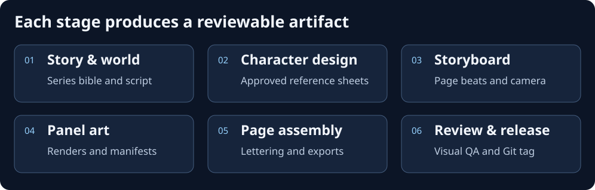
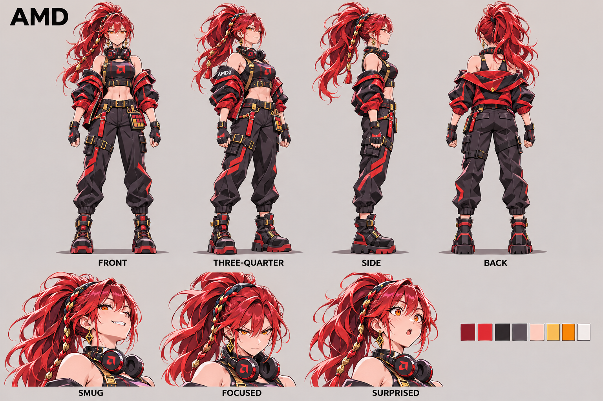
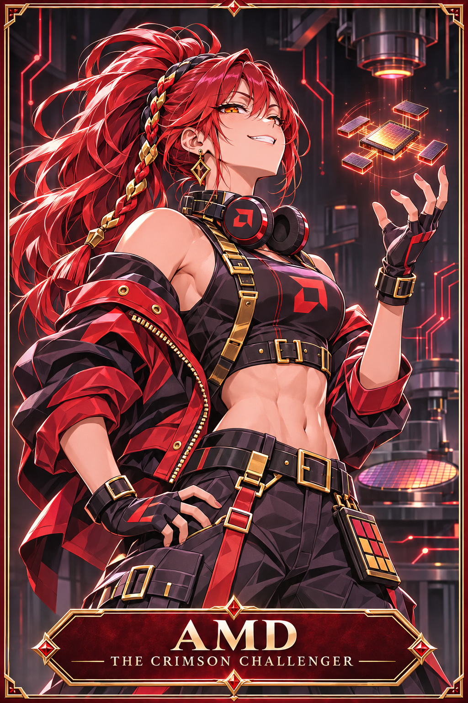
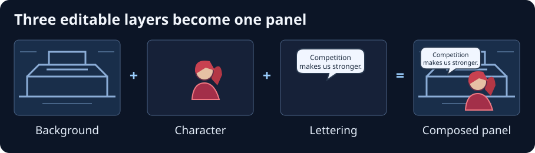
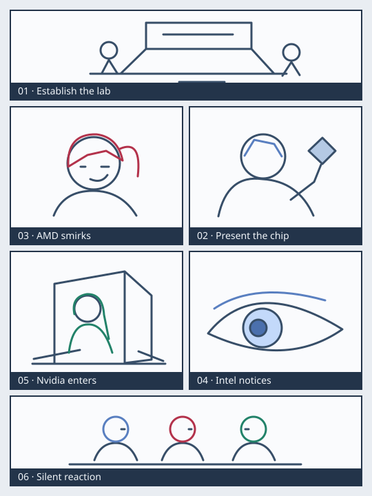

# How to make manga with AI and GitHub

Use Silicon Wars as a running example. The production goal is a sequence of pages with consistent characters, costumes, locations, and visual style. GitHub keeps the source material, review decisions, and accepted revisions together. AI can assist with writing, character design, storyboarding, illustration, lettering, and continuity review.

## 1. Break production into reviewable stages



| Stage | Artifact to review |
| --- | --- |
| Story and world building | Premise, plot, dialogue, personalities, and relationships |
| Character and location design | Character bible, approved outfits, model sheets, expressions, and location references |
| Script and storyboard | Page breaks, panel beats, camera angles, blocking, and balloon space |
| AI illustration | Separate panels or layers, with references and generation settings |
| Assembly and lettering | Page layouts, speech bubbles, sound effects, screentones, and exports |
| Review and publication | Pull request, visual checks, release tag, and reading formats |

Give each stage a file you can review and version independently. If AMD's expression drifts in one panel, replace her layer or that panel and rebuild the affected page.

## 2. Keep characters recognizable



*The illustrated turnaround keeps the same silhouette, proportions, outfit, and accessories across angles. The expression row changes the acting while preserving her face and hair.*



*The portrait card uses the same design in a different pose and setting. Use the written profile to resolve outfit and story details for the scene.*

Build a character bible before rendering chapter one. Collect front, side, three-quarter, and full-body views, then make a small expression sheet with the same face proportions in each drawing. Keep approved images and structured notes beside the character profile. The [character roster](../characters/INDEX.md) and [series bible](../bible/story_bible.md) record existing Silicon Wars designs.

| Field | Intel example |
| --- | --- |
| Identity | Intel, the Blue Empress |
| Archetype | Proud veteran and established power |
| Hair and eyes | Long light-blue hair and sapphire eyes |
| Default outfit | Sapphire crown, royal-blue imperial military coat, gold-fringed epaulettes, wafer-shaped heirloom |
| Personality | Disciplined, strategic, wary of decline |
| Expression studies | Confidence, irritation, exhaustion, embarrassment |
| Checks | Preserve her hair silhouette, face proportions, epaulettes, and accessory design |

Separate **identity** (face, silhouette, hair, distinguishing marks, core accessories) from **scene state** (pose, mood, approved costume variant, carried props, injuries). AMD keeps her red ponytail and Nvidia her emerald hair even as their expressions and poses change.

| Method | Control | Use |
| --- | --- | --- |
| Written character prompts | Low | Exploration and early drafts |
| Image references | Medium | Conversational generation and edits |
| Image references plus pose, depth, or line guides | High | Repeatable blocking and panel production |
| Character LoRA plus references and composition guides | Higher | Recurring characters across a longer series |

A LoRA is a small adaptation for a compatible base model that can help preserve a design across generations. Record its version and strength. A fixed seed helps reproduce a particular setup. Identity can still drift with a new pose, composition, workflow, or model version.

## 3. Generate in units you can revise



| Method | Use |
| --- | --- |
| Generate a whole page from the script and references | Quick thumbnails and layout exploration |
| Generate each panel at its target aspect ratio | Default for production and GitHub review |
| Generate backgrounds, character cutouts, effects, and dialogue separately | Multi-character shots and revisions that affect one layer |

In a lab scene where Intel and AMD argue and Nvidia enters, establish the lab as a background plate. Block the characters against it, using their own reference images, then compose the layers. Use regional guidance or masks if the generator mixes features between characters. Keep lettering editable and reserve balloon space during blocking. You can change Nvidia's expression while keeping the other artwork in place.

## 4. Storyboard before rendering



Use thumbnails, stick figures, or simple rectangles to lay out the action. Specify reading order before assigning geometry. For traditional Japanese manga, the right panel of a paired row is read first. For webtoons, use vertical spacing and reveal points to control pacing.

| Panel | Camera | Story beat |
| --- | --- | --- |
| 1 | Wide | Establish the semiconductor conference lab |
| 2 | Medium | Intel presents her latest chip |
| 3 | Close-up | AMD smirks |
| 4 | Extreme close-up | Intel notices the smirk |
| 5 | Dynamic low angle | Nvidia bursts through the door |
| 6 | Silent reaction | Everyone freezes |

Vary shot size and emotional purpose. Panel 4 turns Intel's attention into a beat of its own. In a thumbnail pass, check eyelines, screen direction, balloon space, and whether the page reads without the dialogue.

## 5. Keep production source in Git

```text
bible/       Series rules, timeline, relationships, and style
characters/  Profiles, art prompts, editable designs, and reference images
chapters/    Chapter scripts, storyboards, page/panel source, and lettering
layouts/     Reusable page geometry and reading order
workflows/   Generator settings and provenance
tools/       Production and export helpers
site/        Static gallery source
scratchpad/  Original group artwork and legacy authoring templates
tutorial/    Illustrated guide
external/    Pinned upstream tools
```

Keep editable panel instructions in text or YAML so you can review individual fields in a diff. Give a panel a stable ID. The chapter starter includes a [sample panel](../chapters/chapter-001/pages/page-001/panel-03.yaml) and [separate lettering](../chapters/chapter-001/lettering.yaml). For a two-shot, a panel definition could look like this.

```yaml
id: chapter-001-page-003-panel-002
status: storyboard_approved
characters:
  - id: amd
    outfit: default
    expression: smug
    pose: arms_crossed
    screen_position: right
  - id: intel
    outfit: default
    expression: annoyed
    screen_position: left
scene:
  location: chip_design_lab
  camera: medium_two_shot
  lighting: overhead
  reading_direction: rtl
dialogue:
  - speaker: amd
    text: "Competition makes us stronger."
render:
  aspect_ratio: "3:2"
  reference_required: true
  version: 1
```

A render agent resolves character IDs to profiles and approved images, builds the generation request, and saves the output beside its instructions. Record the model or checkpoint, workflow revision, seed if available, exact prompt, reference paths and hashes, output file, and selected take. The [manifest template](../workflows/generation-manifest.template.yaml) provides a starting point. These records let you trace cloud generations even when the same pixels cannot be reproduced.

## 6. Review art with branches and pull requests

To fix AMD's expression in chapter 1, page 3, panel 2, start from the approved base and open a narrow branch.

```bash
git switch main
git pull --ff-only
git switch -c art/fix-amd-expression-p003
# Revise the affected instructions and render or layer, then update its manifest.
git add chapters/chapter-001/pages/page-003/
git commit -m "Fix AMD's expression in chapter 1, page 3"
git push -u origin art/fix-amd-expression-p003
```

Open a PR with a short reason, the approved reference, and before/after previews of the panel and assembled page. Check continuity, reading order, and lettering at the intended reading size. For supported image formats GitHub offers side-by-side, swipe, and onion-skin comparisons. For layered files and assets without a usable web diff, attach small flattened PNG previews. [GitHub image comparisons](https://docs.github.com/en/repositories/working-with-files/using-files/working-with-non-code-files#rendering-and-diffing-images)

### Store large editable files with Git LFS

Use regular Git for scripts, prompts, YAML, SVG, and modest previews. For large layered sources, configure LFS before adding them.

```bash
git lfs install
git lfs track "*.kra"
git lfs track "*.psd"
git add .gitattributes
git commit -m "Configure manga source assets"
```

Changed LFS binaries consume storage as additional versions, and downloads consume bandwidth. Check the current allowance for your plan. Keep rejected experiments in local scratch space and commit the accepted take and its metadata. Publish optimized PNG, WebP, or JPEG exports as regular files for GitHub Pages, which does not support LFS objects. [LFS billing](https://docs.github.com/en/billing/concepts/product-billing/git-lfs) · [LFS and GitHub Pages](https://docs.github.com/en/repositories/working-with-files/managing-large-files/about-git-large-file-storage)

## 7. Pick tools by production step

| Tool | Role |
| --- | --- |
| ChatGPT image generation | Concept exploration, reference-guided illustration, targeted edits |
| Krita | Cleanup, layers, lettering, and page assembly |
| ComfyUI | Repeatable node workflows for panel rendering |
| Blender | 3D blocking, pose reference, and camera perspective |
| GitHub | Revisions, pull requests, approvals, and release tags |
| Python and Pillow | Contact sheets, compositing, and exports |

Conversational image generation is useful early, when the design is changing. For repeatable production, save ComfyUI workflow JSON and an API-format export if an automation needs it. Krita AI Diffusion can use sketches, masks, regional prompts, and ComfyUI workflows while you work in the painting app. [ComfyUI workflow docs](https://docs.comfy.org/specs/workflow_json) · [Krita AI Diffusion](https://github.com/Acly/krita-ai-diffusion)

## 8. Give each reviewer a distinct job

Have one reviewer compare faces, costumes, and props with the approved sheets. Have another check story continuity and a third check lettering, panel order, and readability. Ask automated vision reviewers to flag uncertain matches for a person to inspect.

Automated checks can confirm panel paths, dimensions, and dialogue IDs, then build a preview page or upload a contact sheet for review. A person approves the final pages before publication. [GitHub Actions workflow artifacts](https://docs.github.com/en/actions/tutorials/store-and-share-data)

## 9. Study the pinned upstream projects

- **Manga Studio** illustrates a local ComfyUI pipeline with character references, LoRAs, independent panel generation, speech bubbles, and page assembly. Inspect its per-panel workflow and layering approach. [Upstream repository](https://github.com/ahmet360/manga-studio)
- **Comic Pipeline** illustrates outline-to-volume production with editable storyboards, review gates, versioned stages, and PDF/CBZ export. Study how an edit invalidates only dependent stages. [Upstream repository](https://github.com/adachi0130/comic-pipeline)
- **Open Pose & Costume** supplies pose, costume, and character references for staging. **Open Pose & Costume Skill** documents a three-reference workflow where the identity image controls appearance, the pose controls motion, and the outfit controls clothing. [Reference workbench](https://github.com/hongye007/open-pose-costume) · [Companion skill](https://github.com/hongye007/open-pose-costume-skill)

See [external/](../external/README.md) for checkout commands and pinned revisions. Use the upstream tools as implementation references and review their own setup and asset terms.

## 10. Try one six-panel page

Use the [chapter 1 starter](../chapters/chapter-001/README.md) for the Intel vs. AMD scene.

- [ ] Confirm character reference images and lock costume continuity.
- [ ] Review the script, thumbnails, panel order, and balloon space.
- [ ] Generate the six panels at the layout ratios and select a take per panel.
- [ ] Record the generation inputs and keep editable layers for difficult shots.
- [ ] Assemble and letter the page, then read it at publication size.
- [ ] Open a PR with the page preview, merge after approval, and archive the accepted version.

Now change AMD's expression in panel 3. Verify that only the affected panel or layer and its derived page need rebuilding. Then change a line of dialogue and rebuild the lettering from the existing art.

The long-term production flow works like a compiler. The bible, character files, and script feed the storyboard, panel geometry, dialogue, and scene state. A renderer uses those inputs with reference images, models, and compositing instructions. The result can be exported as PNG pages, webtoon images, CBZ, PDF, or a static gallery. When a character design changes, identify every panel that used that design and queue it for review.

For publication, check the terms for company-inspired branding, model outputs, references, and fonts. Build reliable character consistency and panel revisions before automating full chapters.
